<!-- LOCAL CITY-POP BANNER -->
<a href="https://github.com/Jhoslandy">
  <picture>
    <source media="(prefers-color-scheme: dark)" srcset="assets/banner-dark.v12.svg">
    <source media="(prefers-color-scheme: light)" srcset="assets/banner-light.v12.svg">
    
  </picture>
</a>

 

---

## `$ whoami`

  

  Hago software de punta a punta: APIs con Spring Boot, apps Android con Kotlin y tableros en Power BI. 
  Investigo hologramas y realidad aumentada en la UMSA y fundé Code_Cats para aprender en comunidad.

 

## `$ cat tech-stack.yaml`

<table border="1" cellpadding="14" bgcolor="#17171c">
  <thead>
    <tr>
      <th colspan="2" align="left"><code>Jhoslandy:~$ cat tech-stack.yaml</code></th>
    </tr>
  </thead>
  <tbody>
    <tr>
      <td width="50%" valign="top"><code>├─ ⚙ backend_api:</code>  
        
        
        
         
        <code>Java · Spring Boot · JPA · JWT · FastAPI · SQLAlchemy</code>
      </td>
      <td width="50%" valign="top"><code>├─ ▣ mobile:</code>  
        
         
        <code>Kotlin · Jetpack Compose · Android</code>
      </td>
    </tr>
    <tr>
      <td valign="top"><code>├─ ✦ frontend:</code>  
         
        <code>React · Vite · Tailwind CSS</code>
      </td>
      <td valign="top"><code>├─ ◉ data_bi:</code>  
        
         
        <code>PostgreSQL · SQL · Power BI · DAX</code>
      </td>
    </tr>
    <tr>
      <td valign="top"><code>├─ ⌁ languages:</code>  
         
        <code>Java · Kotlin · Python · SQL · DAX</code>
      </td>
      <td valign="top"><code>╰─ ☄ research_community:</code>  
        <code>Hologramas · Realidad Aumentada — Auxiliar de investigación, UMSA</code>  
        <code>Code_Cats — fundador de la comunidad</code>
      </td>
    </tr>
  </tbody>
  <tfoot>
    <tr>
      <td colspan="2"><code>status: building&nbsp;&nbsp;·&nbsp;&nbsp;environment: production</code></td>
    </tr>
  </tfoot>
</table>

---

## `$ ./gradlew skills --radar`

  <picture>
    <source media="(prefers-color-scheme: dark)" srcset="assets/radar-dark.svg">
    <source media="(prefers-color-scheme: light)" srcset="assets/radar-light.svg">
    
  </picture>&nbsp;
  <picture>
    <source media="(prefers-color-scheme: dark)" srcset="assets/radar-langs-dark.svg">
    <source media="(prefers-color-scheme: light)" srcset="assets/radar-langs-light.svg">
    
  </picture>

<code>signals: dev_skill_radar · language_stack_radar · status: healthy</code>

---

<!-- SOCIALS -->
## `$ connect --socials`

&nbsp;&nbsp;
&nbsp;&nbsp;
&nbsp;&nbsp;

 
 

Hecho con 💖 y mucho café desde La Paz, Bolivia · @Jhoslandy

